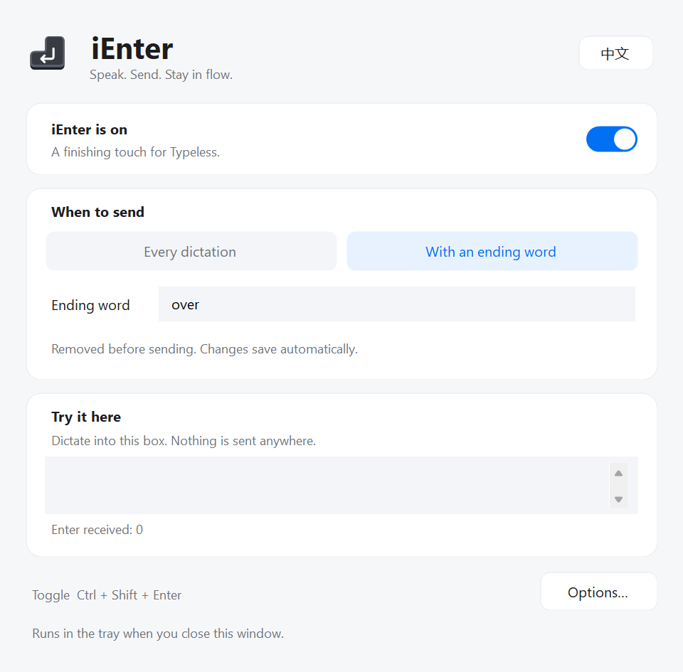

<p align="center"></p>
<h1 align="center">iEnter</h1>
<p align="center">A small Windows companion that presses Enter after Typeless dictation.</p>
<p align="center"><a href="https://github.com/ZhanchiWang/iEnter/releases">Download for Windows</a> · <a href="README.zh-CN.md">中文说明</a> · <a href="LICENSE">MIT license</a></p>

<p align="center"></p>

## Speak, then send

Typeless puts your words into the text box. iEnter handles the last keypress.

- **Every dictation:** press Enter after each Typeless paste.
- **With an ending word:** say “I'll be there in five minutes, over.” iEnter removes `over` and presses Enter. Without the ending word, your text stays in the input box.
- **Your own ending word:** use `over`, `done`, `发送`, or a phrase such as `send now`.
- **English / 中文:** switch the entire interface with the button in the top-right corner. Your choice is remembered.
- **Tray controls:** toggle with **Ctrl + Shift + Enter**, or use the tray menu.
- **App scope and timing:** choose which apps can receive Enter and adjust the delay in **Options**.

iEnter is an independent community project. It is not affiliated with Typeless and does not modify its files or firmware.

## Get started

Previously named Auto Enter. When upgrading, point existing shortcuts and startup entries to `iEnter.exe`.

1. Download `iEnter-v1.3.2-Windows-x64.zip` from [Releases](https://github.com/ZhanchiWang/iEnter/releases) and extract it into a permanent folder. Keep `iEnter.exe.config` beside `iEnter.exe`; it enables sharp per-monitor DPI rendering.
2. Start Typeless, then open `iEnter.exe`.
3. Turn on the switch and choose **Every dictation** or **With an ending word**.
4. Try a dictation in the built-in test box. The **Enter received** counter should increase.
5. Open **Options** to allow your target apps. A fresh installation allows `Codex` plus the built-in test box. Use **Enable in every app** for broader use, or enter process names such as `Codex, Weixin, chrome, msedge`.

The app starts paused on its first run and remembers your choices afterwards. Closing the window keeps it running in the tray; choose **Quit** to exit. The default delay is **500 ms**.

Windows 10/11 **x64** with .NET Framework 4.8 is the intended environment. No installer, Python, Node.js, or administrator privileges are needed. Releases are not code-signed.

### Ending-word behavior

Ending words are matched at the end of the **text Typeless produces**. Matching ignores English letter case and common trailing punctuation. English words do not match inside larger English words: `over` does not match `turnover` or `leftover`.

The word may contain up to 64 characters. An empty setting disables ending-word sending. Saying only the ending word, without a message, does not send an empty message. Changes are saved immediately.

You still stop Typeless recording normally. iEnter does not listen for a live wake word or stop recording, and it cannot match a word that Typeless removes or transcribes differently. Ending-word mode pastes plain text, so rich-text formatting is not retained in that mode. Automatic mode leaves the paste content unchanged.

### What Enter does

The target app decides whether Enter sends, inserts a newline, or performs another action. iEnter sends **Enter only**; it does not add Tab.

Typing, clicking, scrolling, or changing input focus during the delay cancels the pending Enter. Consecutive Typeless pastes reset the timer and result in one Enter. If a modifier key remains held, iEnter waits briefly and then cancels instead of releasing your keys.

The delay is a quiet period after the paste event, not an acknowledgement from the target editor. Increase it for slower apps. Normal-privilege iEnter may not inject keys into an elevated application. Focus checks and keyboard injection cannot be made atomic across processes.

## Privacy and compatibility

iEnter has no network calls, telemetry, accounts, or audio recording. It briefly reads the current paste payload in memory; it does not save dictation text or general keyboard input. Typeless's own data handling is separate.

Settings are stored in `%LOCALAPPDATA%\AutoEnter\settings.json`. This legacy folder is retained so existing Auto Enter settings keep working. To start at login, place a shortcut to the executable in your Windows Startup folder, or configure a Windows login startup entry. The app does not silently install a startup service.

The detector is verified against **Typeless 2.11.0.138 for Windows**. Its native input component marks injected paste events with `dwExtraInfo = 0x54594C45`; iEnter checks that marker, the injected-event flag, and Ctrl+V. Ordinary manual pastes and unrelated unmarked simulated pastes are ignored.

This marker is an internal compatibility detail, not a security identity or an official plugin API. A future Typeless update may require a detector update. Typeless features that reuse the same marked paste path, such as pasting a previous transcript, can also trigger iEnter.

## Build and test

The project uses C# and Windows Forms with the Windows .NET Framework compiler. There are no NuGet dependencies.

```powershell
./build.ps1
./test.ps1
./package.ps1
```

The executable and its configuration are written to `dist/`. Packaging creates a portable ZIP, the executable/configuration pair, and SHA-256 checksums under `release/`.

Optional integration test, using **your locally installed** Typeless input component:

```powershell
./test.ps1 -InputHelperDll "$env:LOCALAPPDATA\Programs\Typeless\resources\lib\input-helper\build\windows\x64\InputHelper.dll"
```

Quit an already-running iEnter instance before integration testing, and leave the local test window focused. The test inserts fixed sample text into its own window and stops if it loses focus. No proprietary DLL is included in this repository or its downloads. GitHub Actions runs the build and rule/settings tests; the optional DLL integration test is local only.

```powershell
# Regenerate icon sizes
./tools/create-icon.ps1

# Render both interface languages without hooks or saved-setting changes
./dist/iEnter.exe --render-preview docs/images
```

## How it is organized

| File | Responsibility |
| --- | --- |
| `src/Engine.cs` | Paste detection, debounce, target checks, cancellation |
| `src/Native.cs` | Windows APIs and ending-word paste transformation |
| `src/Core.cs` | Settings, literal ending-word matching, timing rules |
| `src/UI.cs`, `src/Modern.cs` | Interface, options, local test box, tray |
| `src/Localization.cs` | English / Chinese selection |
| `src/Tests.cs` | Rule, migration, language, and isolated integration tests |

## Credits

The [editable SVG icon](assets/ienter.svg) is an ink-dark L-shaped keycap with a gray bevel and rounded white return arrow. `src/IconArtwork.cs` supplies the same vector geometry to the app header and icon exporter. The Windows icon includes ten native sizes from 16 to 256 px, and the PNG preview is 1024 px.

Inspired by [ConstantineLiu/typeless-autoenter](https://github.com/ConstantineLiu/typeless-autoenter) for macOS. This Windows implementation is independently written; its input-source detection differs because Windows low-level keyboard events do not directly expose the source PID.

The return arrow evolved from [Lucide's corner-down-left](https://github.com/lucide-icons/lucide/blob/main/icons/corner-down-left.svg), with a custom keycap, proportions, and palette. See [icon licenses](assets/LUCIDE-LICENSE.txt). Source code is licensed under [MIT](LICENSE).
