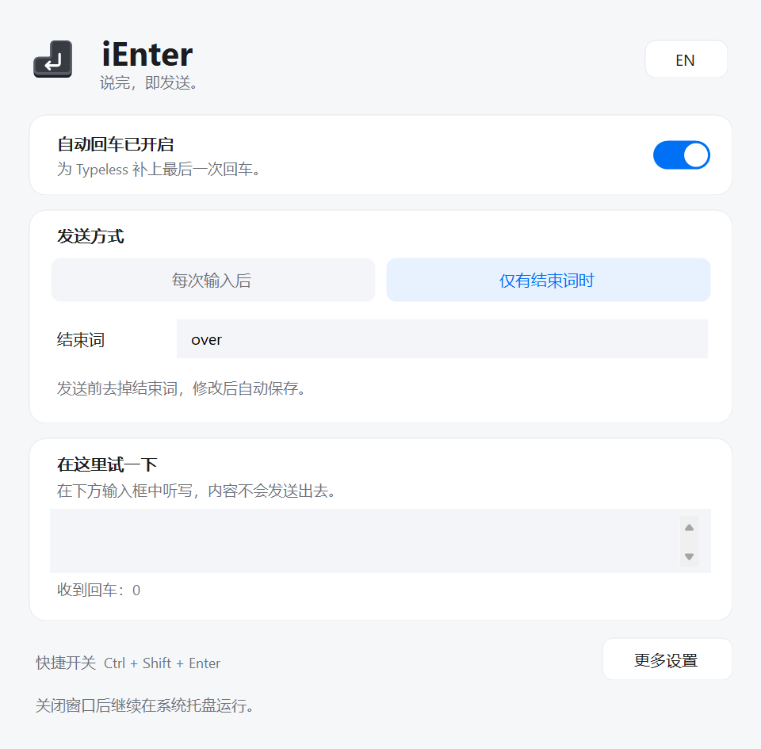

# iEnter

[English](README.md) · [下载 Windows 版](https://github.com/ZhanchiWang/iEnter/releases)

1.2 版采用新的简洁界面，右上角可一键切换 English / 中文。语言、结束词和开关设置都会自动保存。仅发送 Enter，不增加 Tab 动作。应用范围和等待时间放在「更多设置」中。

Windows 托盘小工具：Typeless 粘贴语音识别结果后，自动按一次 Enter。



## 使用

1. 从 Releases 下载 ZIP 并解压，双击 `iEnter.exe`，不需要安装。请将 `iEnter.exe.config` 与程序保存在同一目录，它用于启用高 DPI 清晰显示。源码编译结果位于 `dist/`。
2. 勾选「开启自动回车」。也可以用 **Ctrl + Shift + Enter** 或托盘菜单切换。
3. 选择「每次输入后」或「仅有结束词时」；默认等待 **500 ms**。
   结束词模式下，在「结束词」输入框里填入 `over`、`发送`、`done` 或其他词语，修改后自动保存并立即生效。
4. 在本地测试框中使用 Typeless，下面的 Enter 计数应增加。
5. 在「更多设置」中指定生效程序，例如 `Codex, Weixin, chrome, msedge`，或勾选「在所有应用中生效」。

第一次运行默认暂停，默认程序列表为 Codex，默认结束词为 `over`。之后会记住你的开关、模式、结束词、等待时间和程序列表。关闭窗口会留在托盘；右键托盘图标选择「退出」才能完全退出。

设置继续保存在 `%LOCALAPPDATA%\AutoEnter\settings.json`，兼容改名前的 Auto Enter 配置。将已有桌面快捷方式和开机启动入口改为 `iEnter.exe` 即可。不安装服务，不自动设置开机启动，不修改 Typeless 安装文件，不上传数据，不记录输入内容。

## 两种模式

| 模式 | 效果 |
| --- | --- |
| 每次粘贴后回车 | Typeless 粘贴完成后等待指定时间，再按 Enter。与参考 Mac 项目的基本行为一致。 |
| 自定义结束词 | 结束词设为「发送」后，说「五分钟后到，发送」，Typeless 输出保留这个词时，会移除结尾口令、以纯文本粘贴「五分钟后到」，然后按 Enter。没有口令就正常输入，不回车。 |

结束词支持中文、英文和英文短语（如 `send now`），最多 64 个字符；只匹配句末，忽略英文大小写和末尾常见标点。英文词不会匹配其他英文单词的一部分，例如结束词为 `over` 时，`turnover`、`leftover` 不触发。只说结束词、没有正文时不发送。留空会暂停结束词触发；重新填入即可恢复。修改结束词会取消尚未执行的回车。

这个模式在粘贴前修改本次剪贴板载荷，所以不会用退格去删除目标软件里已有的文字；富文本格式会被转为纯文本。Typeless 原有的剪贴板恢复机制仍由它自己负责。

仍需按原方式结束 Typeless 录音。结束词不会主动停止录音，也不保证 Typeless 一定保留你说出的结束词。

1.1 版会自动兼容旧设置，原来的 `over` 模式和开关保持不变。设置文件新增 `EndWord` 字段；`Mode` 的旧值 `over` 继续表示「结束词模式」。

## 取消与兼容性

- 普通手动粘贴、其他程序的一般模拟粘贴不会触发。
- 等待期间切换窗口、切换输入焦点、点击鼠标、滚轮操作或继续输入，会取消待执行的回车。
- 连续的 Typeless 粘贴会重新计时，最后只按一次 Enter。
- 修饰键仍按着时先等待，超时取消。不会强行释放用户按键。
- Enter 的含义由目标软件决定：聊天框可能发送，文本编辑器可能换行。不能替代目标软件的发送设置。
- 500 ms 是粘贴后的静默等待时间，不是目标软件确认「已经提交」的回调；若目标软件处理较慢，可以在界面中增大等待时间。
- 普通权限运行，不能保证向以管理员身份运行的目标程序发送按键。

已验证环境：Windows x64，Typeless **2.11.0.138**。工具识别该版本原生输入组件写入模拟键盘事件的 `dwExtraInfo = 0x54594C45`，并同时检查注入标志和 Ctrl+V。这个标记是兼容性线索，不是安全身份认证，也不是官方插件 API；未来 Typeless 改变输入机制后可能需要更新本工具。「重新粘贴上一条」等同样使用这个标记的 Typeless 功能也会触发。

## 编译和测试

1.3.2 使用墨色 L 形键帽、灰色倒角与白色圆角回车箭头，增强小图标的辨识度。[SVG 矢量文件](assets/ienter.svg)保留可编辑原稿；界面和图标导出共用 `src/IconArtwork.cs` 中的矢量路径，系统图标包含 16–256 px 的十档尺寸，并支持高 DPI 显示。

需要 Windows x64 和 .NET Framework 4.x 编译器。当前机器已经具备；项目没有 NuGet 或网络运行依赖。

```powershell
.\build.ps1
.\test.ps1

# 可选：使用本机已经安装的 Typeless 原生输入组件做隔离集成测试
.\test.ps1 -InputHelperDll "$env:LOCALAPPDATA\Programs\Typeless\resources\lib\input-helper\build\windows\x64\InputHelper.dll"

# 重新生成图标
.\tools\create-icon.ps1
```

集成测试只往专用的本地测试窗口输入固定测试文本；失去窗口焦点就停止。测试调用本机 DLL，不分发该 DLL，不访问语音服务。测试结果保存在 `test-results/`。

已完成：规则测试、实际 InputHelper.dll 粘贴测试、普通粘贴排除、中文/英文/短语结束词清理、结束词切换和留空、旧设置兼容、开关、应用范围、焦点取消、连续粘贴去重；用户也已确认原版真实 Typeless 语音输入可以自动回车。

## 实现和来源

- `src/Engine.cs`：键盘事件识别、等待与取消、前台目标检查。
- `src/Native.cs`：Windows 调用及本次粘贴载荷处理。
- `src/UI.cs`：设置、本地测试框、托盘。
- `src/Core.cs`：设置、结束词规则、候选事件条件。
- `src/Tests.cs`：规则与隔离集成测试。

交互参考 [ConstantineLiu/typeless-autoenter](https://github.com/ConstantineLiu/typeless-autoenter)，Windows 实现独立编写，未复制其 Objective-C 源码。该 Mac 项目按进程 PID 识别 Cmd+V；Windows 低级键盘事件不直接提供发送进程 PID，所以这里采用已核实的 Typeless 按键标记。

Windows 接口参考：[KBDLLHOOKSTRUCT](https://learn.microsoft.com/en-us/windows/win32/api/winuser/ns-winuser-kbdllhookstruct)、[SendInput](https://learn.microsoft.com/en-us/windows/win32/api/winuser/nf-winuser-sendinput)、[剪贴板接口](https://learn.microsoft.com/en-us/windows/win32/dataxchg/clipboard)。

图标的回车箭头从 [Lucide corner-down-left](https://github.com/lucide-icons/lucide/blob/main/icons/corner-down-left.svg) 演变而来，键帽、比例与配色在本项目中制作。图标许可见 `assets/LUCIDE-LICENSE.txt`；程序源码采用 MIT 许可。
